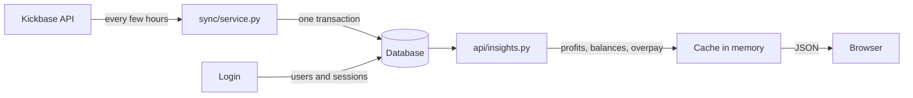

# Development

How the database of Kickbase Insights works and where its data comes from. For the overall picture of the app, see [`docs/architecture.png`](docs/architecture.png) and [`docs/flows.png`](docs/flows.png). For setting up a development environment, see the [README](README.md#development).

- [Development](#development)
  - [The short version](#the-short-version)
  - [Where the database lives](#where-the-database-lives)
  - [Tables and where their data comes from](#tables-and-where-their-data-comes-from)
    - [Shared by all leagues](#shared-by-all-leagues)
    - [Per league](#per-league)
    - [Per user](#per-user)
    - [The app itself](#the-app-itself)
    - [How the tables belong together](#how-the-tables-belong-together)
    - [What is not stored](#what-is-not-stored)
  - [What a sync does](#what-a-sync-does)
    - [Transfers](#transfers)
  - [How the data is read](#how-the-data-is-read)
  - [Rules for the data](#rules-for-the-data)
  - [Private data](#private-data)
  - [Changing the database](#changing-the-database)

## The short version

The database is a local copy of Kickbase. Kickbase is the source of almost everything in it. The app only ever reads from Kickbase, except for bids, the watchlist and collecting the daily login bonus.

- **Writing:** a sync fetches from Kickbase, then stores everything in one transaction. A login stores the user and their session.
- **Reading:** `api/insights.py` builds every API response from the database. It never writes.
- **Nothing calculated is stored.** Profits, balances, overpay and fair values are worked out when a response is built, so changing a formula needs no migration.

## Where the database lives

| | Location |
|---|---|
| SQLite file | `kickbase.db` in the data folder |
| Data folder | `backend/data`, in Docker `/data` (volume `kbi-data`). Set with `KBI_DATA_DIR`. |
| Demo mode | `demo.db` in the same folder, so demo data never ends up in a real database |
| Key for the login sessions | `secret.key` in the same folder, unless `KBI_AUTH__SECRET_KEY` is set |

SQLite runs in WAL mode, so the API keeps reading while a sync writes. That is why `kickbase.db-wal` and `kickbase.db-shm` show up next to the database while the app runs.

**PostgreSQL** is used instead of SQLite when `KBI_DATABASE__HOST` or `KBI_DATABASE__URL` is set. The tables are the same.

> [!NOTE]
> To back up SQLite, stop the app first and copy the whole data folder. Without `secret.key` the stored sessions cannot be read, and everybody has to log in again.

## Tables and where their data comes from

There are 19 tables. A table's name in the database is its class name in lowercase, for example `marketvaluehistory`. The classes are in [`backend/db/models.py`](backend/db/models.py).

How a table is kept up to date:

- **Updated:** rows are changed or added, never removed.
- **Rebuilt:** all rows of the league are deleted and written again, so whatever is gone at Kickbase is gone here too.
- **Added to:** new rows are added, old ones stay.

The Kickbase paths below are all under `/v4`. Kickbase documents none of this, see [kevinskyba/kickbase-api-doc](https://github.com/kevinskyba/kickbase-api-doc) for the community documentation.

### Shared by all leagues

| Table | Holds | Comes from | Kept up to date |
|---|---|---|---|
| `Team` | Clubs and the Bundesliga table | `/competitions/{id}/table` | Updated |
| `Player` | Every player: club, market value, points, status | `/competitions/{id}/teams/{id}/teamprofile`, plus squads and the market for players who are in no club anymore. First name, goals and injury notes come from `/competitions/{id}/players/{id}`. | Updated. `active` turns false once a sync no longer sees the player. |
| `MarketValueHistory` | One row per player, the market values as a JSON list | `/competitions/{id}/players/{id}/marketValue/{days}` | Updated, keeps 730 days |
| `Fixture` | Matches of every matchday | `/competitions/{id}/matchdays` | Updated |

### Per league

| Table | Holds | Comes from | Kept up to date |
|---|---|---|---|
| `League` | Name, competition, current matchday, time of the last sync | `/leagues/selection`, `/leagues/{id}/overview`, `/leagues/{id}/ranking` | Updated, also by a login |
| `LeagueSeason` | Start of the season, start money, how far the stored transfers reach | `dt` and `b` of `/leagues/{id}/overview` | Updated. The last known values stay if Kickbase leaves them out. |
| `Manager` | Managers with placement, points and team value | `/leagues/{id}/overview`, `/leagues/{id}/managers/{id}/dashboard`, `/leagues/{id}/ranking` | Rebuilt |
| `SquadEntry` | Who owns which player and what they paid | `/leagues/{id}/managers/{id}/squad` | Rebuilt |
| `MarketListing` | Players on the transfer market | `/leagues/{id}/market` | Rebuilt |
| `Transfer` | Every transfer of the league | `/leagues/{id}/managers/{id}/transfer` | Added to, kept forever |
| `MatchdayRanking` | Points, placement and team value per matchday | `/leagues/{id}/ranking?dayNumber=N` | Added to. Only the current matchday is fetched again, older ones are `final`. |
| `Battle`, `BattleEntry` | The battles of the league and their standings | `/leagues/{id}/overview`, `/leagues/{id}/battles/{type}/users` | Rebuilt |

### Per user

| Table | Holds | Comes from | Kept up to date |
|---|---|---|---|
| `User` | A Kickbase account that logged in | `/user/login` | Updated at login |
| `UserLeague` | Which leagues a user is in, and their real budget | `/leagues/selection`, `/leagues/{id}/me/budget` | Updated at login and by a sync |
| `UserSession` | A login: the hash of the cookie and the encrypted Kickbase token | `/user/login` | Added at login, removed when it ends or expires |
| `MarketBid` | A user's own bids | `/leagues/{id}/market` | Rebuilt per user |

### The app itself

| Table | Holds | Kept up to date |
|---|---|---|
| `SyncRun` | Every sync with its status, requests and stats, shown on the Status page | Added to, keeps the last 500 |
| `SchemaInfo` | The version of the tables, see [Changing the database](#changing-the-database) | One row |

### How the tables belong together

The tables have no foreign keys on purpose: rebuilt tables are deleted and written again on every sync, and a transfer has to outlive the manager who made it. They belong together through their ids:

| Column | Points to |
|---|---|
| `league_id` | `League.id` |
| `player_id` | `Player.id` |
| `manager_id`, `buyer_id`, `seller_id` | `Manager.id`, together with `league_id` |
| `user_id` | `User.id` |
| `team_id`, `team1_id`, `team2_id` | `Team.id` |
| `type` in `BattleEntry` | `Battle.type`, together with `league_id` |

A user and a manager are the same Kickbase account, so `User.id` and `Manager.id` match for anybody who logged in.

### What is not stored

Live points, lineups, a player's matches and the watchlist are fetched from Kickbase when somebody opens them. Live points are kept in memory for a short time, see `api/live.py`. Passwords are never stored.

## What a sync does

The code is in [`backend/sync/service.py`](backend/sync/service.py).

**When it runs:**

| Trigger | When |
|---|---|
| `schedule` | By default at 02:10, 06:10, 10:10, 14:10, 18:10 and 22:10 (`KBI_SYNC__SCHEDULE`) |
| `startup` | When the app starts and the last sync is older than 30 minutes |
| `login` | After a login, for leagues without fresh data |
| `manual` | The button on the Status page, at most every 2 minutes |

**Which leagues:** the ones of the account in `.env`, and the ones of everybody with an active session. A league nobody can reach is not synced until somebody logs in again. Only one sync runs per league at a time.

**The steps:**

1. **Fetch.** All requests happen first, nothing is written yet. If a request for the basics fails (table, matchdays, overview, market, teams, squads), the sync stops and the stored data stays as it was. If a smaller one fails (a dashboard, a battle, a ranking, a player, a transfer list), the sync goes on without it and counts it in `failed_requests`.
2. **Store.** Everything is written in one transaction, so readers see the old data or the new data, never half of it. `League.synced_at` is set here, which also retires the cached responses.
3. **Private data.** Budget and bids are refreshed for every other member with an active session, two requests each.

**A sync only fetches what can have changed:**

| Data | Fetched when |
|---|---|
| Player details | The status changed, the player is on the market, or the details are older than 12 hours |
| Market value history | Kickbase updated the values, which happens at 22:00 German time. A history fetched within the hour after that is fetched once more, the new values may not all be out yet. The first fetch reaches back a year, later ones a quarter. |
| Rankings | Only matchdays that are not `final` |
| Transfers | Each list is read until its first entry that is already stored, usually one request per manager |

### Transfers

`Transfer` is the one table Kickbase cannot simply refill, so it works differently:

- The source is each manager's transfer list. It reaches back over seasons, and it belongs to one manager, so that manager's id is certain. The activity feed is no use here: it forgets entries after about a month and only has names.
- The entries have no id of their own. The same transfer has the same player and date on both managers' lists, so `(player_id, date)` is what identifies it, and a trade ends up as one row with both ids.
- `LeagueSeason.transfers_complete_since` matches `started_at` once all lists were read without a failure. If it does not match, for example after a reset or a failed list, the next sync reads every list down to the start of the season.
- Transfers of earlier seasons stay in the table. Reading skips everything before `LeagueSeason.started_at`.

## How the data is read

[`backend/api/insights.py`](backend/api/insights.py) builds the responses, and the formulas are in [`backend/core/analytics.py`](backend/core/analytics.py). Neither writes anything.

Responses are cached in memory per league, viewer and `League.synced_at`, so a new sync replaces them all by itself. The cache holds up to 512 responses and is empty after a restart. A bid drops the bidder's own responses right away.

## Rules for the data

- **Managers are identified by id, never by name.** Names can change and two managers can share one. Names are looked up when a response is built. `Transfer.buyer` and `seller` only matter for managers who left before ids were stored.
- **Times are UTC.** `UTCDateTime` refuses a datetime without a timezone and always hands back one with UTC, because SQLite has no timezones.
- **Money is a `BigInteger`.** Team values do not fit in 32 bits.
- **Market value days count from 1970-01-01,** as Kickbase sends them. A day's value only applies from 22:00 German time that evening, until then the day before still counts. Use `analytics.market_value_day()` instead of working it out.
- **A missing `SquadEntry.purchase_price` means the player was assigned at the season start.** Kickbase sends no price for those.

## Private data

| What | How it is protected |
|---|---|
| Real budget (`UserLeague.budget`) | Only ever shown to its owner. Other managers get an estimate from the start money and the transfers. |
| Bids (`MarketBid`) | Only shown to the user who placed them. Responses with private data are cached per viewer. |
| Kickbase token (`UserSession.token_encrypted`) | Encrypted with the key from `secret.key` or `KBI_AUTH__SECRET_KEY` |
| Session cookie (`UserSession.id`) | Only its SHA-256 hash is stored |

## Changing the database

The app has no migration tool. `init_db()` in [`backend/db/__init__.py`](backend/db/__init__.py) runs at every start and creates whatever table is missing.

| Change | What to do |
|---|---|
| A new table | Just add it, it gets created on the next start |
| A new column on an existing table | It is not added by itself. Add a small step to `init_db()`, like `_add_transfer_ids()`. |
| Anything else, or the stored data has to go | Bump `SCHEMA_VERSION` |

> [!WARNING]
> Bumping `SCHEMA_VERSION` deletes **every** table on the next start. Everybody has to log in again, and leagues nobody logs in to stay empty. Most data comes back with the next sync, but the transfers of managers who left and market values older than a year do not. Prefer a new table where possible.

A database made by a newer version than the code stops the app from starting, instead of being rebuilt.
