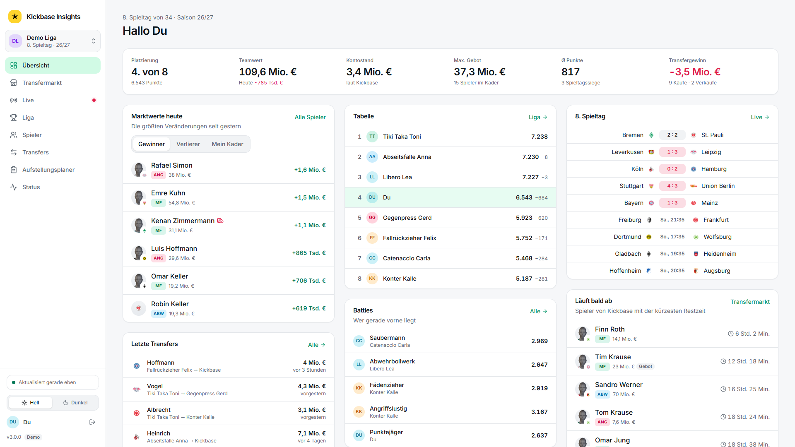
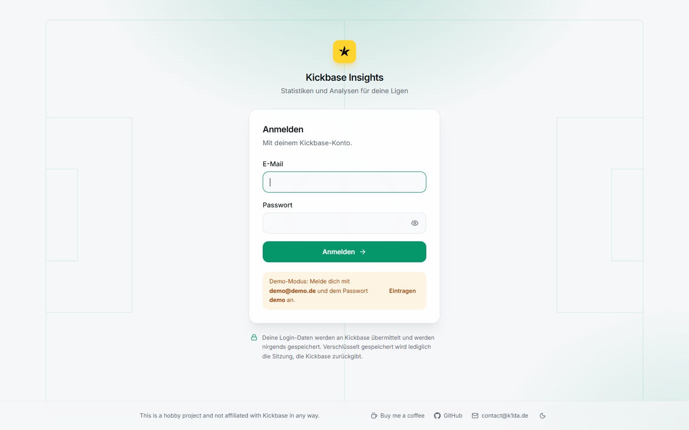
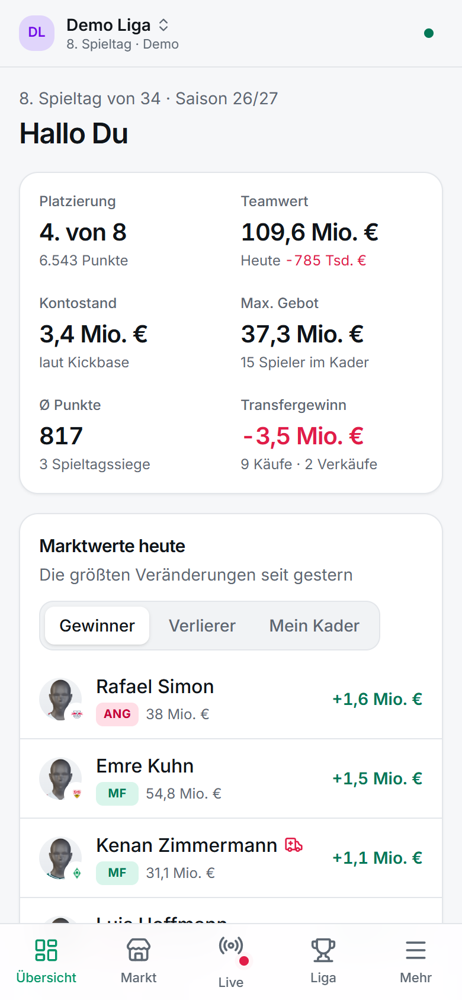
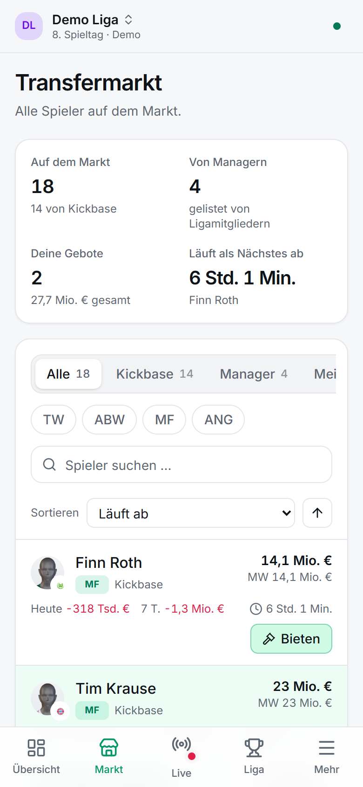
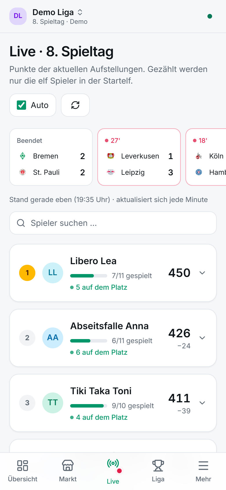
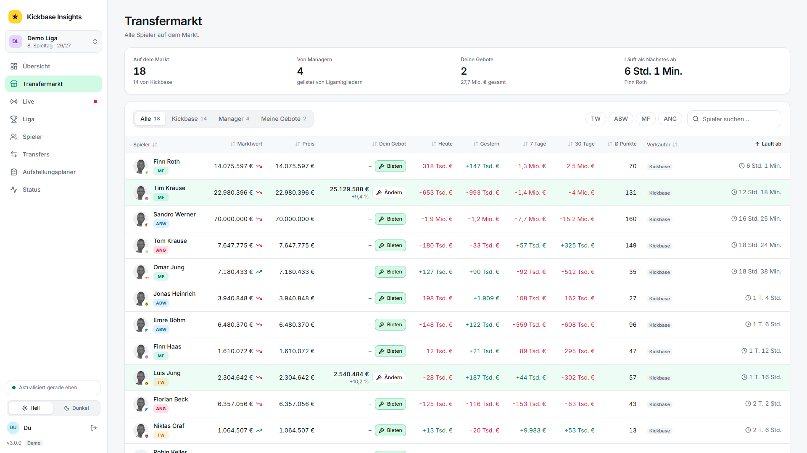
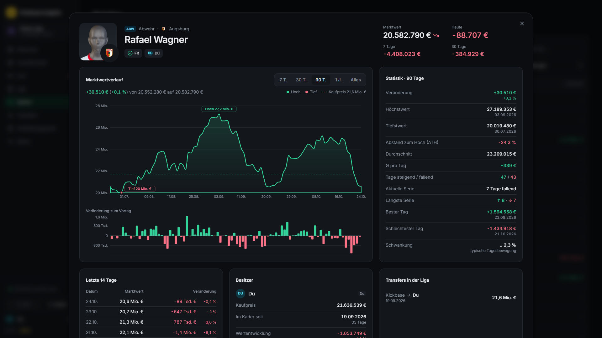
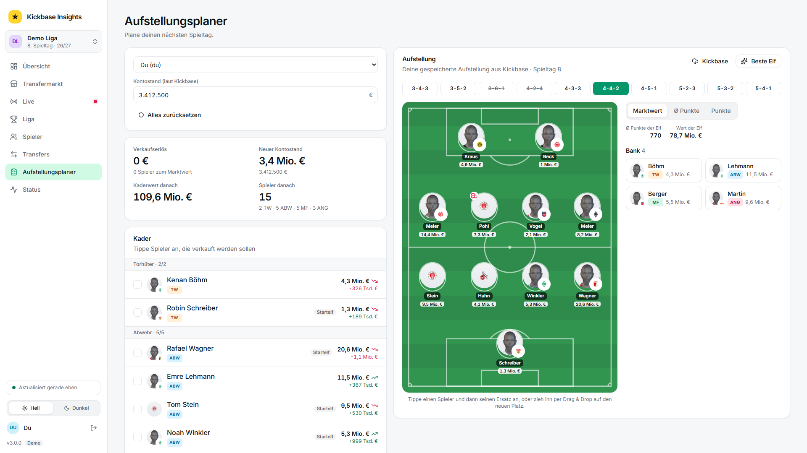
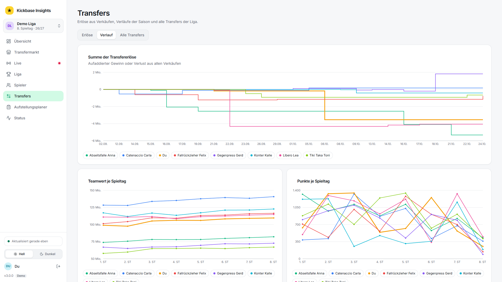

<div align="center">
  <a href="https://de.kickbase.com/"></a>
  <br>
  <h1>Kickbase Insights</h1>
  Self-hosted statistics and analysis for your <a href="https://www.kickbase.com/">Kickbase</a> league, as an alternative to the Pro/Member abonnement.

  ---

  <!-- Placeholder for badges -->
   

</div>

> [!NOTE]
> This is a hobby project and not affiliated with Kickbase in any way. Feel free to create issues and contribute.

##### Table of Contents
- [Features](#features)
- [Screenshots](#screenshots)
- [Quick start](#quick-start)
  - [Docker](#docker)
- [Configuration](#configuration)
- [Coming from v2.x](#coming-from-v2x)
- [Reverse proxy](#reverse-proxy)
- [Development](#development)
- [Planned for the future](#planned-for-the-future)
  - [Thanks to](#thanks-to)
  - [License](#license)

---

## Features

- **Your own login** – everyone signs in with their own Kickbase account and sees their own leagues, with a switcher when they are in more than one. Budgets and bids stay private, exactly as in Kickbase.
- **Übersicht** – your placement, team value, real budget and max bid, today's biggest market value movers, listings about to expire, the league table and the current matchday at a glance.
- **Transfermarkt** – every listing with price, markup, your own bid, market value changes (today, yesterday, 7 and 30 days) and a live countdown. Place, change or withdraw your bids right there.
- **Spieler** – all players of the competition with market value trends, owner and gain since purchase. Tap a player anywhere for the player screen: on desktop a large view with a detailed market value chart (high, low and purchase price marked), the daily changes as bars, statistics for 7 days up to the whole history (best and worst day, rising and falling streaks, distance to the high, volatility), the last 14 days, the ownership, the league's transfers of that player, and the points of every matchday with the last results and the next opponents. On phones the same as a compact sheet.
- **Live** – live points of the current matchday, counted for all players, with goals, assists, cards and the scoring events of every player.
- **Liga** – table, battles and the Bundesliga table. The estimated balances and max bids of the other managers ("Kontostände") are off unless enabled with `KBI_ALLOW__BALANCES`.
- **Transfers** – profit of every sale, summed transfer revenue over time, team value, points and placement per matchday and the full transfer feed.
- **Aufstellungsplaner** – your eleven on a pitch, like in the Kickbase app. It starts with the lineup saved in Kickbase; switch formations, swap players by tapping or with drag and drop, or let it pick the best eleven by average points. Mark players to sell and see the new balance and which formations you can still field.
- **Player portraits** everywhere players show up, with the club badge in the corner. Where the Kickbase API only sends the club's placeholder, the portrait comes from Kickbase's picture pool on its CDN, for some players still from an earlier season.
- **Mobile first, wide screen ready** – bottom navigation on phones, sidebar on desktop, up to three columns and every table column on large screens, light and dark mode (following the system until you pick one).
- Optional Discord notifications for failed syncs and collected login bonuses.

## Screenshots

> [!TIP]
> Shown with the built-in demo data (`KBI_DEMO=true`).




<p align="center">
  
  
  
</p>






## Quick start

Everything (web interface, API and the scheduled sync) runs in one container on one port.

### Docker

```bash
curl -O https://raw.githubusercontent.com/casudo/Kickbase-Insights/main/docker-compose.yml
curl -o .env https://raw.githubusercontent.com/casudo/Kickbase-Insights/main/.env.example
### edit .env to configure your settings
docker compose up -d
```

Open `http://<host>:8000` and log in with your Kickbase account. Your leagues are synced right after the first login, which takes a minute or two.

## Configuration

All settings are environment variables with the `KBI_` prefix, nested settings use a double underscore. See [`.env.example`](.env.example) for a commented template.

| Variable | Default | Description |
| --- | --- | --- |
| `KBI_AUTH__ALLOWED_LEAGUES` | all | Comma separated league names or IDs this server is for. Only these leagues are synced and shown, people in none of them cannot log in. Recommended for public servers. |
| `KBI_AUTH__SESSION_DAYS` | `30` | How long a login lasts at most. It ends earlier when Kickbase expires its token. |
| `KBI_AUTH__SECRET_KEY` | generated | Encrypts the stored Kickbase session tokens. Without it a key is generated once and kept in `/data/secret.key`. |
| `KBI_KICKBASE__EMAIL` | – | An account that keeps your leagues synced while nobody is logged in, and collects its daily bonus. |
| `KBI_KICKBASE__PASSWORD` | – | Password of that account. |
| `KBI_KICKBASE__LEAGUE` | all its leagues | Name or ID of the league that account keeps synced. It is listed first for everyone. Its owner still sees all their leagues after logging in. |
| `KBI_KICKBASE__START_DATE` | estimated | The instant the season started or your league was reset, ISO 8601 with UTC offset, e.g. `2026-08-01T18:00:00Z`. Feed events before it are ignored and players assigned at the start are valued at their market value back then. |
| `KBI_KICKBASE__START_MONEY` | `50000000` | Starting money, `200000000` for "Ohne Team". Used to estimate the other managers' balances. |
| `KBI_KICKBASE__COLLECT_BONUS` | `true` | Collect the daily login bonus on every sync. |
| `KBI_KICKBASE__DISCORD_WEBHOOK` | – | Discord webhook for failed syncs and collected bonuses. |
| `KBI_KICKBASE__COMPETITION_ID` | `1` | `1` is the Bundesliga. |
| `KBI_SYNC__SCHEDULE` | `10 2,6,10,14,18,22 * * *` | Cron expression for the sync. |
| `KBI_SYNC__TIMEZONE` | `TZ` or `Europe/Berlin` | Timezone the schedule is evaluated in. |
| `KBI_SYNC__LIVE_CACHE_SECONDS` | `45` | How long live points are reused before Kickbase is asked again. |
| `KBI_API__PORT` | `8000` | Port of the web server. |
| `KBI_API__FORWARDED_ALLOW_IPS` | `127.0.0.1` | Proxies whose `X-Forwarded-*` headers are trusted. Set to `*` behind Traefik or nginx in a Docker network, so login cookies are marked secure over HTTPS. |
| `KBI_API__HIDE_HEALTH_CHECKS` | `false` | Leave the `GET /api/health` requests out of the container log. |
| `KBI_ALLOW__BALANCES` | `false` | Show everyone the estimated balances and max bids of the other managers. Your own balance is always shown. |
| `KBI_ALLOW__BALANCES_USERS` | – | Comma separated Kickbase user names or IDs who see the "Kontostände" even when they are off. |
| `KBI_DATABASE__HOST` | – | PostgreSQL host. Without it an SQLite database in `/data` is used. |
| `KBI_DATABASE__PORT` / `__DATABASE` / `__USERNAME` / `__PASSWORD` | `5432` / `kickbase` / `kickbase` / – | PostgreSQL connection. |
| `KBI_DATABASE__URL` | – | A full SQLAlchemy URL, wins over the fields above. |
| `KBI_DEMO` | `false` | Run with generated sample data, no Kickbase account needed. Always uses its own SQLite file. |
| `KBI_DEBUG` | `false` | Verbose logging. |

## Coming from v2.x

v3 is a complete rewrite and a clean start, not an update: it reads nothing of v2, neither its settings nor its data.

1. Stop and remove the v2 container. Its JSON data is not used anymore and can be deleted.
2. Write a new `.env` from [`.env.example`](.env.example). The v2 variables (`KB_MAIL`, `KB_PASSWORD`, `KB_LIGA`, `DISCORD_WEBHOOK`, `START_DATE`, `START_MONEY`, `RUN_SCHEDULE`) are ignored, every setting has a `KBI_` name now, see [Configuration](#configuration).
3. Start v3 as in the [Quick start](#quick-start). Everything runs on port `8000`, the ports `3000` and `5000` are gone. The first sync builds the database from Kickbase.

## Reverse proxy

Point your proxy at port `8000` of the container and set `KBI_API__FORWARDED_ALLOW_IPS=*`, so the app knows it is served over HTTPS and marks its login cookie as secure. With Traefik:

```yaml
http:
  routers:
    kickbase:
      service: kickbase
      rule: Host(`your.domain.de`)
      entryPoints:
        - websecure
      tls:
        certResolver: cloudflare
  services:
    kickbase:
      loadBalancer:
        servers:
          - url: http://<container_hostname>:8000
```

## Development

**Backend**
```bash
cd backend
python -m venv .venv
source .venv/bin/activate
pip install ".[dev]"
cp ../.env.example .env
python main.py start
python main.py sync
ruff check . && ruff format .
```

**Frontend**
```bash
cd frontend
npm install
npm run dev
npm run build
```

`KBI_DEMO=true` runs the whole app with two generated leagues, handy to work on the frontend without touching your Kickbase account. Log in with `demo@demo.de` and the password `demo`.

---

## Planned for the future

- Fix player circles on the "Aufstellungsplaner" page
- All text should be put into an i18n localization system

---

### Thanks to

- [@kevinskyba](https://github.com/kevinskyba) for the Kickbase API v4 documentation

### License

This project is licensed under the MIT License - see the [LICENSE](LICENSE) file for details.
